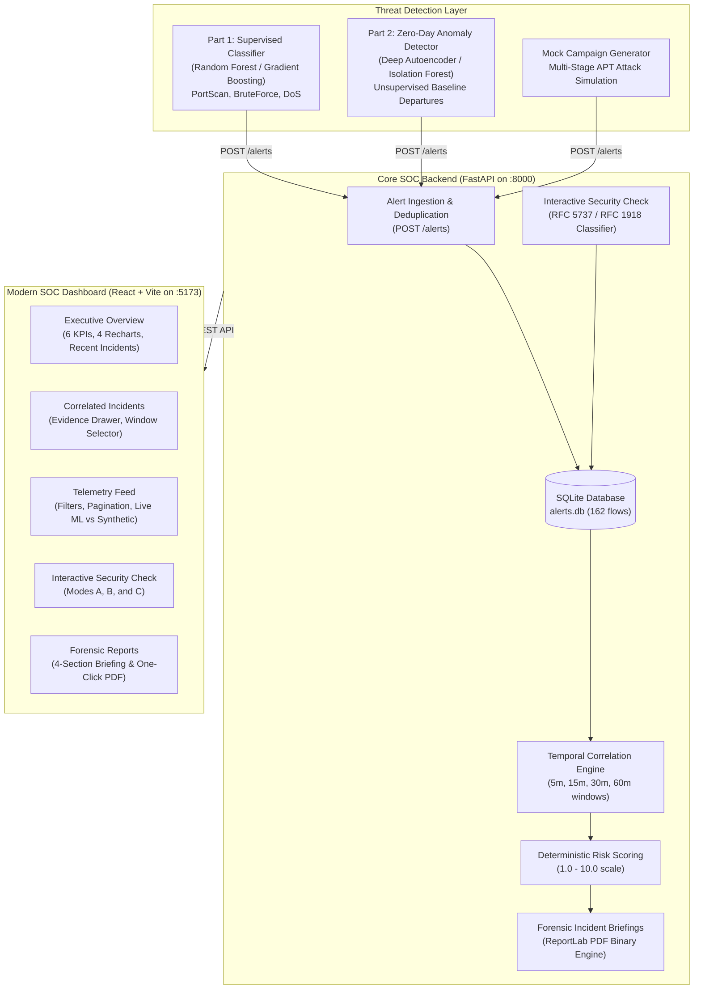

# Dell Security Operations Center (SOC) & Multi-Stage NIDS-CTI System

An end-to-end Network Intrusion Detection System (NIDS) and Cyber Threat Intelligence (CTI) platform featuring supervised machine learning classification, deep autoencoder anomaly detection, temporal multi-stage attack correlation, automated executive forensic reporting with binary PDF export, and a modern React.js SOC dashboard.

---

## Architecture Overview



---

## Project Structure

```text
cnproj/
├── README.md                          # Root system documentation
├── .gitignore                         # Project-wide exclusion rules
│
├── part1/                             # Supervised ML Intrusion Detection
│   ├── detector.py                    # Real-time alert emitter from trained models
│   ├── part1_classifier.ipynb        # Model training, feature selection, evaluation
│   ├── demo_flows.csv                 # Held-out evaluation flows
│   ├── requirements.txt               # Part 1 dependencies
│   ├── models/                        # Serialized Random Forest & HistGradientBoosting models
│   └── figures/                       # Confusion matrices and ablation studies
│
├── part2/                             # Unsupervised Zero-Day Anomaly Detection
│   ├── anomaly.py                     # Real-time anomaly score evaluator & alert emitter
│   ├── train.py                       # Autoencoder and Isolation Forest training pipeline
│   ├── prep.py                        # Feature transformations and PyTorch Autoencoder architecture
│   ├── requirements.txt               # Part 2 dependencies
│   └── models/                        # Autoencoder weights (autoencoder.pt) and scaler bundles
│
└── part3/                             # Central SOC, Telemetry, Correlation & UI
    ├── server.py                      # FastAPI REST application
    ├── db.py                          # SQLite database access layer
    ├── alerts.db                      # Persistent SQLite telemetry database (162 alert records)
    ├── correlation.py                 # Sliding temporal window correlation & risk engine
    ├── security_check.py              # RFC network classifier & deep IP history analysis
    ├── report_generator.py            # Local heuristic / Gemini AI report generator & PDF exporter
    ├── mock_alerts.py                 # Multi-stage adversary campaign simulator
    ├── requirements.txt               # Backend dependencies
    │
    ├── frontend/                      # Modern React.js Single-Page Application
    │   ├── package.json               # Frontend dependencies (React 19, Vite, Recharts, Lucide)
    │   ├── vite.config.js             # Vite development server configuration
    │   ├── src/
    │   │   ├── api/api.js             # Centralized Axios REST client
    │   │   ├── styles/theme.css       # Cybersecurity dark-navy theme & responsive utility classes
    │   │   ├── components/            # Reusable UI widgets (Sidebar, Topbar, MetricCard, SeverityBadge)
    │   │   └── pages/
    │   │       ├── Overview.jsx       # SOC Executive Dashboard with Recharts & KPI cards
    │   │       ├── SecurityCheck.jsx  # Interactive Security Check (Modes A, B, and C)
    │   │       ├── Incidents.jsx      # Correlated incidents feed & evidence drawer
    │   │       ├── Telemetry.jsx      # Paginated alert feed with multi-parameter filtering
    │   │       └── Reports.jsx        # 4-section executive briefing & binary PDF export
    │   └── public/                    # Favicon and static assets
    │
    └── tests/
        └── test_soc_cti.py            # Comprehensive 25-test pytest suite
```

---

## Core Capabilities

### 1. Multi-Stage Temporal Incident Correlation
- Automatically clusters disparate alerts originating from the same threat actor within configurable sliding windows (`5m`, `15m`, `30m`, `60m`).
- Identifies multi-phase attack campaigns (e.g. `PortScan -> BruteForce -> Denial of Service`).
- Computes deterministic threat risk scores on a normalized **1.0 to 10.0 scale**:
  $$\text{Risk Score} = \min\left(10.0, (\text{Base} + \text{Synergy} + \text{Volume} + \text{Scope}) \times (0.7 + 0.3 \times \text{Confidence})\right)$$
- Categorizes incident severity:
  - **CRITICAL**: $\ge 8.0$ (multi-stage attack chains / weaponized exploits)
  - **HIGH**: $\ge 6.0$ (sustained brute-force or exploitation attempts)
  - **MEDIUM**: $\ge 3.5$ (isolated scanning or anomaly spikes)
  - **LOW**: $< 3.5$ (single low-confidence flows)

### 2. Interactive Security Check
- **Mode A (Threat Actor Deep IP Lookup)**:
  - Strict RFC address classification: correctly distinguishes RFC 1918 private space, loopback, link-local, documentation ranges (RFC 5737 TEST-NET-1/2/3), and public internet.
  - Sourced alert history calculation (e.g. 112 flows for `203.0.113.11`).
  - Optional target filter matching and targeted infrastructure breakdown (destination hosts and destination ports).
  - One-click copyable perimeter containment firewall rules (`iptables -A INPUT -s <IP> -j DROP`).
- **Mode B (Live Alert Ingestion & Pipeline Validation)**:
  - Validates network flow schemas, port bounds (1–65535), and confidence ranges.
  - Rejects duplicates with `deduplicated` status tags.
- **Mode C (Raw Syslog / Flow Parser)**:
  - Ingests raw unstructured text logs (SSH auth logs, Cisco ASA firewall drops, Nginx/Apache WAF logs).
  - Automatically extracts IOCs and supports one-click ingestion directly into the database.

### 3. Forensic Executive Incident Reports & PDF Export
- Generates 4 comprehensive sections for every correlated incident:
  1. **Executive Summary & Attack Nature** ("What Happened")
  2. **Observed Forensic Telemetry & Evidence** ("Evidence Analysis")
  3. **Threat Severity & Impact Assessment** ("Severity Rating")
  4. **Prescribed Containment & Remediation Roadmap** ("Action Plan")
- Operates 100% offline using a built-in deterministic cybersecurity heuristic engine (or optionally via Google Gemini API).
- Exports executive-ready PDF deliverables compiled on the fly using ReportLab.

---

## Quick Start Guide

### Prerequisites
- Python 3.10+
- Node.js 18+ and npm

### 1. Start the Core FastAPI Backend
```bash
cd part3
pip install -r requirements.txt
python server.py
```
*The FastAPI receiver will be running at `http://127.0.0.1:8000` (API documentation available at `http://127.0.0.1:8000/docs`).*

### 2. Start the React.js SOC Dashboard
In a separate terminal:
```bash
cd part3/frontend
npm install
npm run dev
```
*The React SOC Dashboard will launch at `http://localhost:5173`.*

*(Optional)* Compile a production build:
```bash
npm run build
```

---

## Testing & Verification

Run the complete automated test suite covering API contracts, deduplication, temporal correlation, RFC classification, and PDF generation:

```bash
pytest part3/tests/test_soc_cti.py -v
```

All 25 unit and integration tests pass cleanly:
- `test_api_health`: API status and DB connectivity
- `test_api_ingest_valid_alert`: Alert ingestion pipeline
- `test_api_deduplication`: Duplicate signature suppression
- `test_api_reject_malformed_timestamp`: Timestamp ISO format validation
- `test_api_reject_invalid_port`: Port bounds validation (1–65535)
- `test_api_reject_invalid_confidence`: ML confidence score boundaries [0.0, 1.0]
- `test_api_filtering_and_pagination`: Telemetry pagination and filtering
- `test_api_stats_reconciliation_and_delete`: DB telemetry reconciliation
- `test_correlation_temporal_grouping`: Sliding window incident clustering
- `test_correlation_chronological_sequence_verification`: Multi-phase sequence tracking
- `test_correlation_deterministic_risk_scoring`: 1.0–10.0 score formula verification
- `test_correlation_synthetic_tagging`: Synthetic alert tagging
- `test_report_generation_no_key_uses_heuristic`: Offline report fallback
- `test_report_generation_gemini_failure_triggers_fallback`: LLM error recovery
- `test_markdown_section_parser_robustness`: 4-section report parser
- `test_pdf_export_validity`: ReportLab binary PDF compilation
- `test_pdf_export_xml_escaping_special_characters`: XML safe escaping
- `test_full_pipeline_integration`: End-to-end ingestion-to-report pipeline
- `test_security_check_mode_a_ip_classification_and_history`: Mode A history calculation
- `test_security_check_mode_b_submit_alert`: Mode B submission endpoint
- `test_security_check_mode_c_log_parsing`: Mode C syslog extraction
- `test_security_check_ip_classification_rfc5737_vs_rfc1918`: RFC 5737 vs RFC 1918 distinction
- `test_security_check_mode_a_target_filter_omitted_vs_specified`: Target filter semantics
- `test_security_check_mode_a_correlated_incident_and_risk_reconciliation`: Incident reconciliation
- `test_api_new_endpoints_for_react_frontend`: REST endpoints serving the React frontend

---

## API Endpoints Reference

| Method | Endpoint | Description |
|---|---|---|
| `GET` | `/health` | Service health status and database connectivity |
| `GET` | `/stats` | Basic telemetry counts and label distributions |
| `GET` | `/stats/overview?time_window_minutes=15` | Aggregated dashboard bundle (KPIs, top destinations, incident severity) |
| `GET` | `/alerts` | Paginated alert telemetry feed with multi-parameter filtering |
| `POST` | `/alerts` | Ingest new intrusion alert with schema validation and deduplication |
| `DELETE` | `/alerts` | Purge stored alert telemetry |
| `GET` | `/incidents?time_window_minutes=15` | Retrieve correlated incidents clustered by temporal window |
| `GET` | `/incidents/{incident_id}` | Retrieve single incident details, attack progression, and evidence |
| `POST` | `/security-check/analyze-ip` | Mode A: Deep IP investigation, RFC classification, and infrastructure breakdown |
| `POST` | `/security-check/parse-log` | Mode C: Parse raw syslog or network flow strings for IOCs |
| `POST` | `/incidents/{incident_id}/report` | Generate 4-section executive incident report |
| `GET` | `/incidents/{incident_id}/pdf` | Stream binary ReportLab PDF deliverable |

---

## Threat Telemetry Simulation

Simulate live adversarial attack campaigns against the SOC backend:

```bash
# Dispatch 20 test alerts
python part3/mock_alerts.py --count 20 --delay 0.2

# Simulate a coordinated multi-stage APT campaign (PortScan -> BruteForce -> Anomaly -> DoS)
python part3/mock_alerts.py --campaign --delay 0.3

# Continuous live streaming simulation
python part3/mock_alerts.py --loop --delay 0.5
```